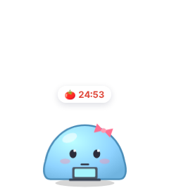
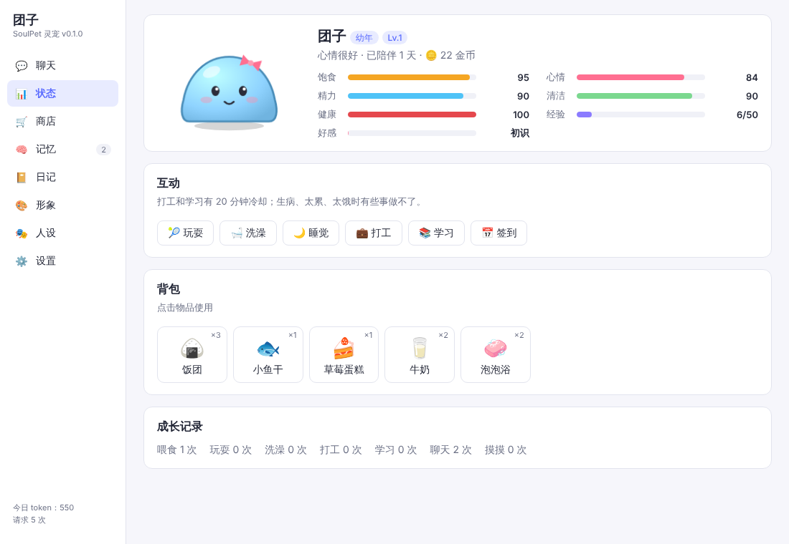
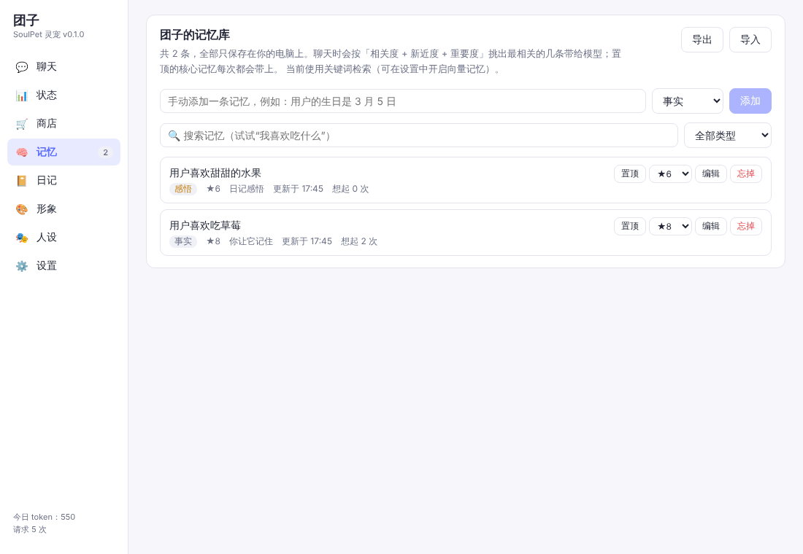
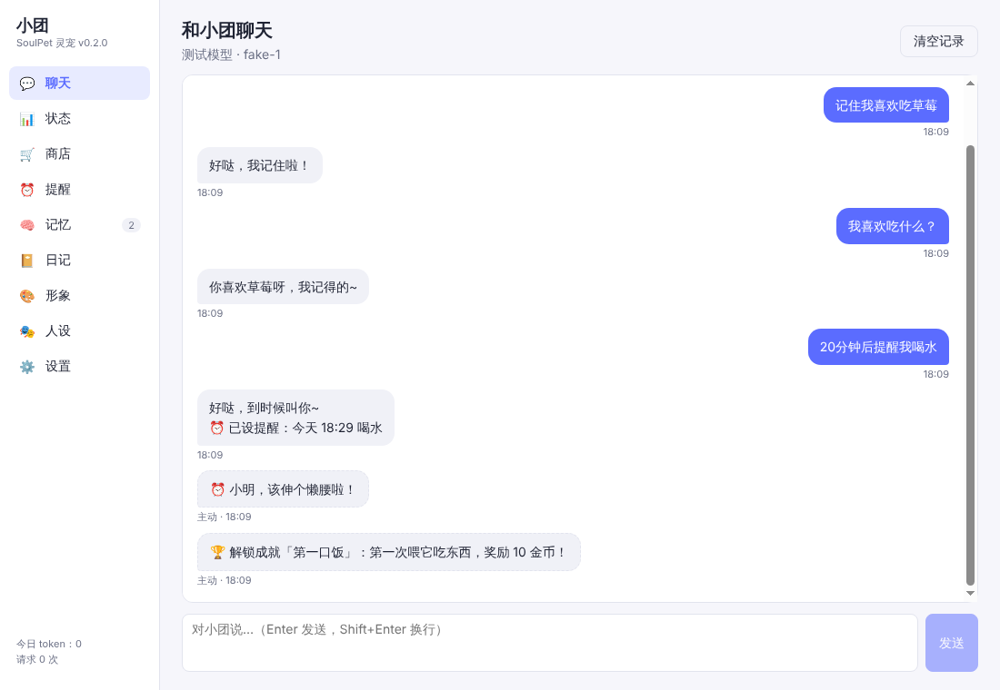
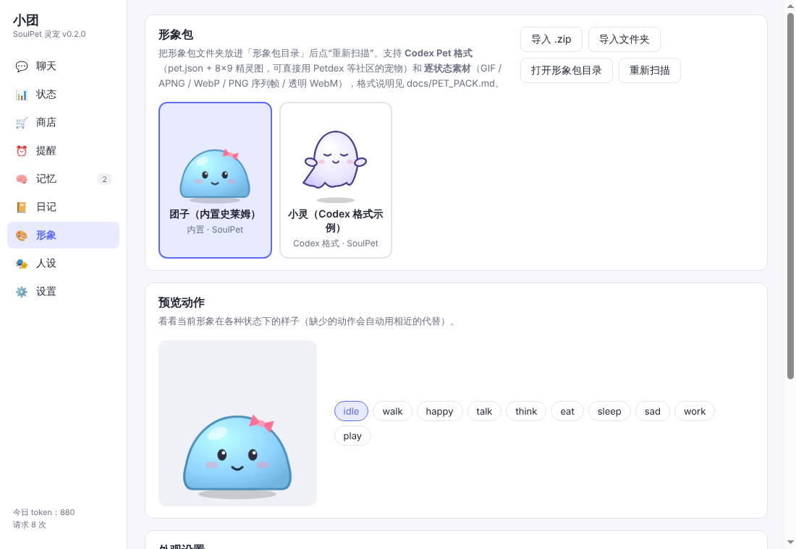
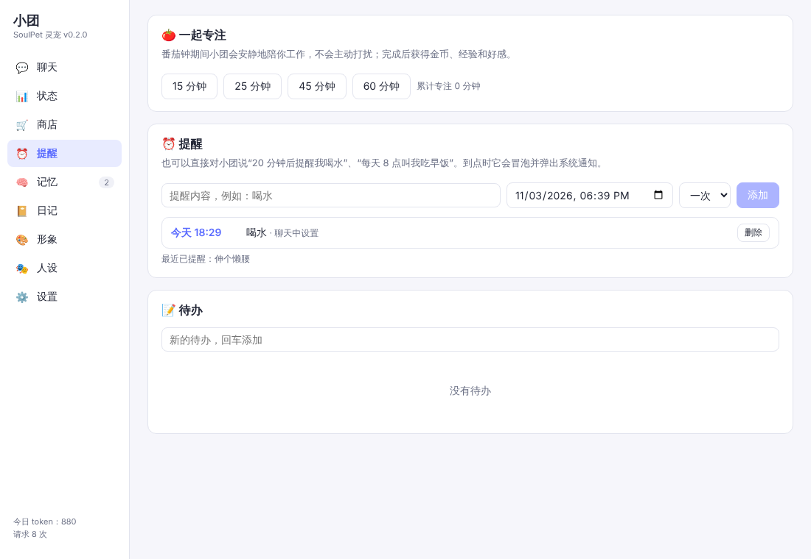
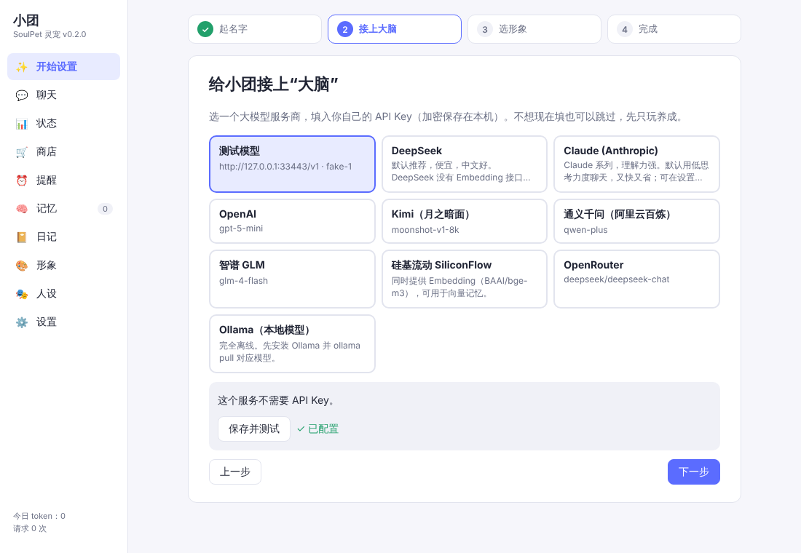

# SoulPet 灵宠

一只住在你桌面上的电子宠物：**长相可以换**，**需要你照顾**，**能用大模型和你聊天**，还**记得你们之间发生过的事**。

<p>
  
  
  
</p>

| 状态与养成 | 记忆库 |
| --- | --- |
|  |  |
| **聊天** | **形象** |
|  |  |
| **提醒 / 番茄钟** | **首次启动引导** |
|  |  |

> 📖 **[使用说明 / 常见问题](docs/USER_GUIDE.md)** · [更新记录](CHANGELOG.md) · 需求整理见 [docs/REQUIREMENTS.md](docs/REQUIREMENTS.md) · 开源项目调研和选型理由见 [docs/RESEARCH.md](docs/RESEARCH.md)

## 功能

**🎨 自定义形象**
- 内置原创矢量史莱姆「团子」，有 20 种状态和表情，可以换颜色、加饰品（蝴蝶结、猫耳、王冠……）
- **兼容 Codex Pet 格式**（`pet.json` + 8×9 精灵图）：[Petdex](https://github.com/crafter-station/petdex) 等社区的数千只宠物可以直接用
- 也支持逐状态素材：GIF / APNG / WebP / PNG 序列帧 / 透明 WebM 视频，可以分幼年、少年、成年阶段设置不同素材
- 在面板里一键从 .zip 或文件夹导入形象包
- **用一张图片做宠物**：选一张透明背景的图，自动加上呼吸、蹦跳、冒爱心等动作
- **Live2D 模型（实验性）**：导入 `*.model3.json` 模型，会动作、会张嘴、眼睛跟着鼠标（需要自行下载 Live2D 官方运行库）
- **AI 生成形象**：描述一下想要的样子（“戴围巾的小企鹅”），图像模型画出来后自动抠图，直接变成桌宠
- 缺少的动作自动用相近的动作代替，最少只要一个 `idle` → [形象包格式](docs/PET_PACK.md)

**🍙 养成系统**
- 饱食、心情、精力、清洁、健康五项数值，会随时间变化；另有好感（亲密度称号）、经验等级、成长阶段、金币
- 喂食、洗澡、玩耍、睡觉、打工赚钱、学习、每日签到；12 种物品和商店
- 18 个成就；偶尔有小惊喜（捡到金币、窗外掉进来一个苹果、睡着了说梦话……）
- 关掉程序期间也会温和地结算（最多 12 小时，有保底）。宠物不会死，但被冷落了会饿、会生病、会难过
- 休闲 / 标准 / 硬核三档难度

**🤖 接入 AI**
- DeepSeek、Claude、OpenAI、Kimi、通义千问、智谱、硅基流动、OpenRouter、Ollama 本地模型等，任何 OpenAI 兼容接口都能用
- 流式回复，宠物头顶气泡逐字显示；模型输出的情绪标签（如 `[happy]`）驱动表情和动画
- 自定义人设，可导入 SillyTavern 角色卡（PNG / JSON）
- 宠物的饥饿、困倦、生病状态会影响它说话的语气
- 主动搭话：早安晚安、你回到电脑前、它饿了困了、太久没理它……有频率档位、每日上限和安静时段
- **能帮你做事**：对它说“20 分钟后提醒我喝水”“每天 8 点叫我吃早饭”“帮我记一下周五交报告”，它会设提醒和待办（任何模型都能用，不需要 function calling）
- 语音：按住 🎤 说话（语音识别），也可以让它用系统语音朗读回复
- 知道今天是什么节日、你们认识多少天了；可选接入天气（下雨提醒带伞）
- API Key 用系统钥匙串加密保存；可设每日 token 上限；可设网络代理

**🧠 自己的记忆库**
- 每轮对话后，后台让模型判断要**新增 / 更新 / 删除**哪些记忆（mem0 式），自动去重，新信息会覆盖旧的
- 你说“记住……”会立刻记下，并设为高重要度
- 混合检索：关键词 BM25（中文可用）+ 可选向量（Embedding）+ 时间新近度 + 重要度。没有 Embedding 接口（比如只用 DeepSeek）也能用
- 置顶的“核心记忆”每次都带上；长期没被想起的记忆权重会慢慢下降（遗忘曲线）
- 每天写日记，从中提炼对你的新认识，并记下“那天聊了什么”的情节摘要
- 定期“做梦”整理记忆：合并重复的记忆，忘掉很久没想起的琐事
- 记忆面板可以搜索、编辑、置顶、删除，也可以导入导出。所有数据只保存在本机

**⏰ 提醒、待办、番茄钟**：到点时它会冒泡并弹出系统通知；专注时它会抱着小电脑陪你工作，不打扰你，完成后有奖励。

**🖥 桌宠基本功**：透明置顶窗口，会在屏幕底部闲逛；拖到哪儿就停在哪儿（屏幕顶部也行，可选重力），支持多显示器；单击摸摸、双击聊天、右键弹出小菜单（🎤 说话 / ⌨ 打字）、悬停显示状态；鼠标穿透模式、透明度；Windows 上全屏看视频 / 玩游戏时自动躲起来；系统托盘、免打扰、开机自启、全局快捷键（默认 `Ctrl+Alt+P`）；你离开电脑太久它会睡着。首次启动有引导，三步就能用起来。

## 使用

### 下载

在仓库的 Releases 页面（`SoulPet soulpet-v*`）或 [Actions](../../actions) 的构建产物里下载：

- Windows：`SoulPet-x.y.z-win-x64.exe`（安装版）或 `.zip`（解压即用）。在 `SoulPet.exe` 旁边新建一个 `SoulPetData` 文件夹，就会把数据存到这里（便携模式）
- macOS：`.dmg`；Linux：`.AppImage`

> 安装包没有代码签名，Windows SmartScreen / macOS Gatekeeper 可能会提示，选择“仍要运行”即可。

### 第一次使用

1. 第一次启动会弹出引导：给宠物起名 → 选模型服务商（默认 DeepSeek）并填入 API Key → 选形象
2. 宠物出现在屏幕右下角。**双击它**开始聊天。试试说“记住我喜欢吃草莓”，过一会儿再问“我喜欢吃什么？”
3. 试试“半小时后提醒我站起来活动一下”；或者托盘图标 → 🐾 照顾它 → 🍅 一起专注
4. 想用向量记忆：设置 → 记忆 → 打开“向量记忆”，选硅基流动的 bge-m3（免费）并填 Key
5. 遇到问题：设置 → 通用 → 查看日志（日志里不会记录 API Key）

### 从源码运行

```bash
npm install          # 已附带 .npmrc（legacy-peer-deps）
npm run dev          # 开发模式（热重载）
npm test             # 单元测试
npm run build && npm run test:e2e   # 端到端测试（Linux 需 xvfb-run 与全局 playwright）
npm run dist:win     # 打包 Windows（也可以用 dist:mac / dist:linux）
```

推送到 GitHub 后，CI 会跑单元测试，在 Linux 和真实的 Windows 上跑端到端测试，并分别打包 Windows、macOS、Linux 安装包；推送 `soulpet-v*` 标签会生成 Release 草稿。

## 项目结构

```
src/core/       纯 TS 核心逻辑（养成、AI 客户端、记忆、形象包、人设、主动搭话）——全部有单元测试
src/main/       Electron 主进程（窗口移动、托盘、IPC、加密存储、后台服务）
src/preload/    安全桥接（渲染进程拿不到 API Key）
src/renderer/   宠物窗口 + 控制面板（React）
resources/      图标、示例形象包（小灵，Codex 格式）
docs/           需求、调研、架构、形象包格式
tests/          单元测试 + Electron 端到端测试
```

更多细节见 [docs/ARCHITECTURE.md](docs/ARCHITECTURE.md)。

## 路线图

- ~~v0.2~~：首次启动引导、提醒 / 待办 / 番茄钟、让 AI 设提醒、记忆整理、成就、随机事件、语音朗读、鼠标穿透、zip 导入形象包、代理、日志
- ~~v0.3~~：语音输入、节日与天气、全屏自动躲起来（Windows）、一张图做宠物、AI 生成形象、Live2D（实验性）、两轮代码审查修复
- **下一步**：Live2D 用真实模型验证、本地 Embedding（完全离线）、多只宠物同屏互动、插件 / MOD、自动更新

接手开发请先读 [docs/HANDOFF.md](docs/HANDOFF.md)。

## 致谢与许可

设计参考了 VPet、DyberPet、dsh-pet、AIRI、yoji、Desk-Pet、mem0、Generative Agents 等项目和论文（见 [调研报告](docs/RESEARCH.md)）。本项目没有复制其中任何 GPL/AGPL 代码，也没有使用受限的美术素材。

- 代码：MIT
- 内置形象「团子」（代码绘制）：MIT；示例形象「小灵」：CC0
- 你导入的第三方形象包遵循各自的许可证
