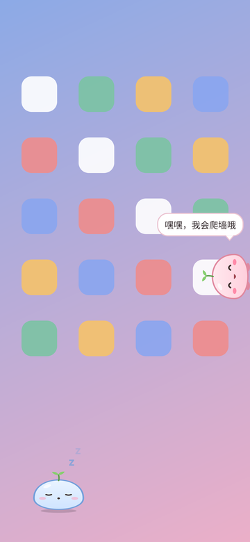
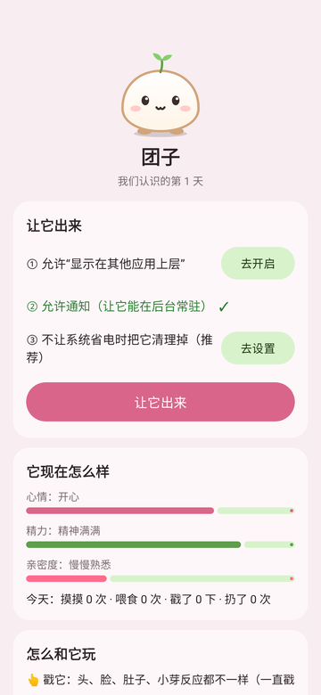
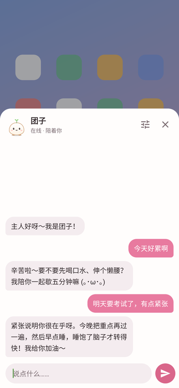
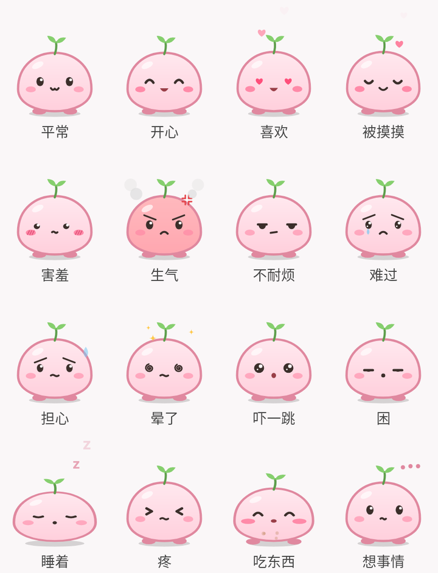
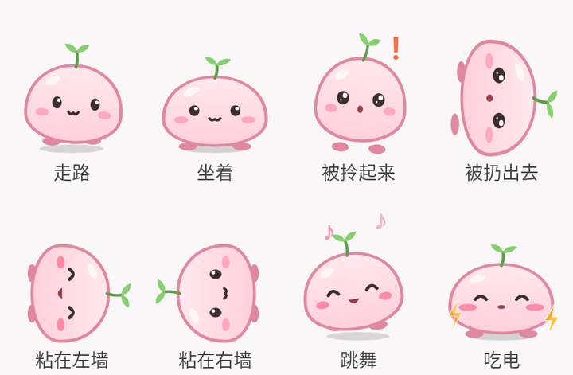

# AI 小桌宠（安卓）

一只住在手机屏幕上的小家伙「团子」。重点不是聊天，而是**它像活的一样**：
它有身体（会掉下来、能被拎起来扔出去、会弹、会晕、会粘在墙上爬），
会对你的每一下触碰有反应，能感觉到你的手机在发生什么，没人理它的时候也有自己的小日子。

**16 种表情**

**姿势**

> 截图都是用 App 本身的绘制代码直接生成的（`app/src/test/.../RenderTest.kt`），不是效果图。
> 需求和设计决定见 [docs/需求说明.md](docs/需求说明.md)。

## 它能做什么

**摸它、戳它、扔它**
- 👆 **戳**：头（被摸头很开心）、脸（害羞/“别捏我脸”）、肚子（怕痒）、小芽（“别拽我的叶子！”）反应都不一样
- 😤 **一直戳**：先是不耐烦，再戳就真生气了——气鼓鼓冒烟，转身走开，过一阵才消气
- 🤚 **在它身上来回蹭** = 摸摸：眯眼、冒爱心，还能把它哄好
- ✊ **按住再拖** = 拎起来（脚会晃）；**松手甩出去**会飞、会转圈、会弹；摔重了“哎哟”，太狠会眼冒金星；老扔它它会难过
- 🧱 **轻轻扔到墙上**：像史莱姆一样粘住，还会自己往上爬，玩够了再跳下来
- 💨 **快速划过它** = 推它一下
- 📋 **按住不动再松开** = 菜单：🍪 喂零食（零食从天上掉下来，它接住吃掉）/ 💬 聊天 / 💤 哄睡 / 👋 收起

**它感觉得到你的手机**
- 🔓 **锁屏久了回来**：你会先看到它在睡觉，然后它醒过来跟你打招呼——离开越久越激动；每天第一次还会说“我们认识第 N 天啦”
- 🔌 **充电** = 它在“吃电”（冒小闪电）；拔早了它会说没吃饱；**电量低**它会饿得没力气，快没电时直接躺倒
- 📳 **摇手机**它会晕；**斜着拿手机**它会往低的那边滑
- 🎵 **手机在放音乐**它会跟着跳舞；插上耳机它会好奇你在听什么
- 🌙 **晚上**它会犯困，11 点提醒你睡觉；饭点提醒你吃饭

**它有自己的小日子**
- 心情、精力、无聊、烦躁、亲密度会随时间和你的对待慢慢变化，决定它接下来做什么
- 没人理时：东张西望、溜达、坐下发呆、伸懒腰、哼歌、自己蹦着玩、爬墙、做白日梦、困了就睡
- 无聊久了会跑到屏幕中间跳起来找你；被惹生气了会背过身去生闷气
- 记得你们认识了多少天、今天摸了它几次、喂了几次、扔了几次

**全部在手机本地运行，不需要 AI、不需要联网。** AI 聊天是可选的附加功能。

---

## 安装（3 分钟）

1. **下载安装包**：在手机上下载 `AiPet-v版本号.apk`（本仓库 Releases 页面，或别人直接发给你的文件）。
2. **安装**：点开下载好的文件。如果手机提示“禁止安装未知来源应用”，按提示允许浏览器/文件管理器安装一次即可。
3. **打开「AI小桌宠」**，照着第一张卡片做：
   - ① 允许“显示在其他应用上层”（必须）
   - ② 允许通知（让它在后台常驻）
   - ③ 关闭电池优化（推荐，防止被系统清理）
4. 点 **“让它出来”**，回到桌面就能看到它啦。
5. （可选）想让它能聊天：在“可选：让它能聊天（AI）”里选一家 AI 服务、粘贴 API Key，点“测试一下”看到 ✓ 就成功了。

### （可选）API Key 是什么、去哪拿？

API Key 是 AI 服务给你的一串“钥匙”，App 用它替你去问 AI。每家都要先注册、充一点钱（或用免费额度）。

| 服务 | 适合谁 | 申请地址 |
|---|---|---|
| **DeepSeek** | 国内网络、想省钱（充几块钱能聊很久） | platform.deepseek.com |
| **智谱 GLM** | 想先免费试试（glm-4-flash 免费） | open.bigmodel.cn |
| 通义千问 / Kimi / 硅基流动 | 国内网络 | 见 App 内链接 |
| **Claude** | 海外网络、想要最好的聊天质量 | platform.claude.com |
| 自定义 | 用 OpenAI 或中转服务 | 填接口地址即可 |

App 里每个选项下面都有“点这里去申请”的按钮。钥匙只保存在你自己的手机里。

## 常见问题

**它过一会儿自己消失了？**
国产手机（小米、华为、OPPO、vivo 等）清理后台比较狠。请在系统设置 → 应用 → AI小桌宠 里：打开“自启动”，电池/耗电管理选“无限制”或“允许后台运行”。

**点了“让它出来”没反应？**
回 App 看第 ① 步是不是还没打勾。小米手机还要在“应用权限”里允许“显示悬浮窗”。

**它说“钥匙不对 / 余额不足 / 连不上”？**
按它说的检查：Key 有没有复制完整、账户有没有余额。选 Claude 的话，中国大陆网络是连不上的，换成 DeepSeek 等国内服务即可。

**会不会很费电 / 费流量？**
屏幕关掉时它会停下动画和所有感应（摇晃/倾斜/音乐）；不聊天就完全不联网。

**它老待在屏幕底部，挡住 App 的按钮了？**
它多半在屏幕两侧活动。可以把它扔到墙上让它粘着；或者在设置里关掉“有重力”，它就放哪儿待哪儿；临时不想看到它，按住它再松开 → 收起。

**更新版本会丢设置吗？**
不会。直接安装新版本覆盖即可，设置和聊天记录都在。

---

## 给开发者

- 原生 Kotlin，minSdk 26（Android 8.0），targetSdk 35，无 Compose，依赖很少。
- 结构：
  - `pet/PetView.kt`：用 Canvas 画的桌宠：16 种表情、9 种姿势、特效、果冻弹簧
  - `pet/Physics.kt`：重力、扔、弹跳、撞墙、粘墙爬、倾斜滑动（纯逻辑，有测试）
  - `pet/Brain.kt`：心情/精力/无聊/烦躁/亲密度，对每件事的反应，没人理时自己找事做（纯逻辑，有测试）
  - `pet/Gestures.kt`：点 / 连点 / 按住拎起 / 来回摸 / 快划 的识别（纯逻辑，有测试）
  - `pet/Senses.kt`：亮屏解锁、充电电量、耳机、音乐、摇晃倾斜（不需要额外权限）
  - `pet/Lines.kt`：本地台词库
  - `pet/PetController.kt`：把上面这些和悬浮窗、菜单、零食、气泡连在一起
  - `pet/ChatPanel.kt` / `BubbleWindow.kt`：悬浮聊天窗口和头顶气泡
  - `pet/PetService.kt`：前台服务、通知、主动搭话、朗读
  - `chat/ChatEngine.kt`：聊天记录、调用 AI、事件分发
  - `ai/`：Claude（官方 `anthropic-java` SDK）和 OpenAI 兼容接口客户端
- 构建：`./gradlew assembleRelease`（APK 在 `app/build/outputs/apk/release/`）
- 测试：`./gradlew testDebugUnitTest`（逻辑测试 + 把界面渲染成 PNG 到 `app/build/renders/`）
- CI：`.github/workflows/aipet-android.yml` 每次改动都会打包；合并到 `main` 后自动发布到 Releases（tag `aipet-v*`，不会占用仓库“最新版本”标记）。
- **签名**：`keystore/aipet.jks` 是一把固定钥匙（密码写在 `app/build.gradle.kts` 里），目的是让每个新版本都能直接覆盖安装。它是公开的，所以任何人都能做出“签名相同”的安装包——只从你信任的地方下载更新即可。如果以后要正式分发，换一把私密钥匙放进 GitHub Secrets。
