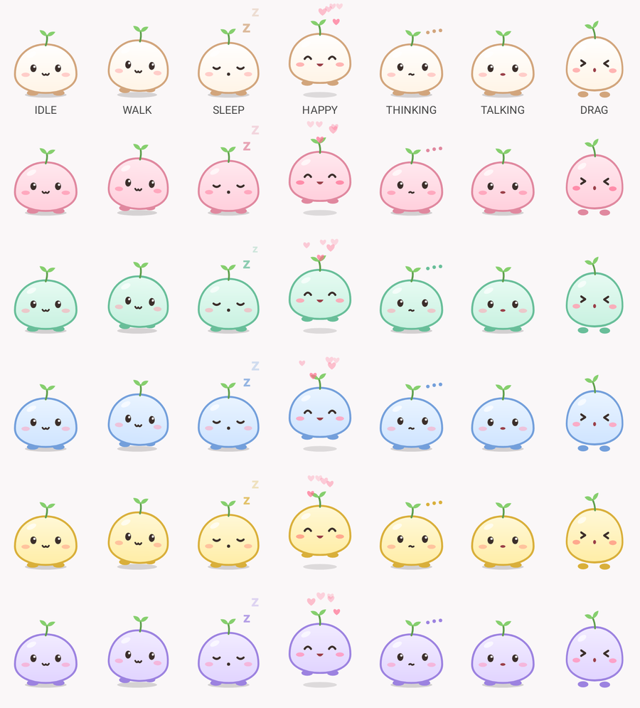

# AI 小桌宠（安卓）

一只住在手机屏幕上的 AI 小宠物「团子」：浮在所有 App 上面，会溜达、眨眼、打瞌睡；点它就能聊天，它会用 AI 回复你，偶尔还会主动关心你。

> 以上截图都是用 App 本身的绘制代码直接生成的（见 `app/src/test/.../RenderTest.kt`），不是效果图。

需求和设计决定见 [docs/需求说明.md](docs/需求说明.md)。

---

## 安装（3 分钟）

1. **下载安装包**：在手机上下载 `AiPet-v版本号.apk`（本仓库 Releases 页面，或别人直接发给你的文件）。
2. **安装**：点开下载好的文件。如果手机提示“禁止安装未知来源应用”，按提示允许浏览器/文件管理器安装一次即可。
3. **打开「AI小桌宠」**，照着第一张卡片做：
   - ① 允许“显示在其他应用上层”（必须）
   - ② 允许通知（让它在后台常驻）
   - ③ 关闭电池优化（推荐，防止被系统清理）
4. **接上 AI 大脑**：选一家 AI 服务，粘贴 API Key，点“测试一下”看到 ✓ 就成功了。
5. 点 **“让它出来”**，回到桌面就能看到它啦。

### API Key 是什么、去哪拿？

API Key 是 AI 服务给你的一串“钥匙”，App 用它替你去问 AI。每家都要先注册、充一点钱（或用免费额度）。

| 服务 | 适合谁 | 申请地址 |
|---|---|---|
| **DeepSeek** | 国内网络、想省钱（充几块钱能聊很久） | platform.deepseek.com |
| **智谱 GLM** | 想先免费试试（glm-4-flash 免费） | open.bigmodel.cn |
| 通义千问 / Kimi / 硅基流动 | 国内网络 | 见 App 内链接 |
| **Claude** | 海外网络、想要最好的聊天质量 | platform.claude.com |
| 自定义 | 用 OpenAI 或中转服务 | 填接口地址即可 |

App 里每个选项下面都有“点这里去申请”的按钮。钥匙只保存在你自己的手机里。

## 怎么玩

- **点它** → 打开聊天窗口（不会离开你正在用的 App）
- **长按** → 摸摸头，它会开心地冒爱心
- **按住拖动** → 换个地方待着（会记住位置）
- **点头顶的气泡** → 打开聊天看完整内容
- **通知栏** → 聊天 / 收起 / 退出

放着不管的时候它会自己溜达，十几分钟没人理就会睡着（深夜更容易困），点一下就醒。

## 常见问题

**它过一会儿自己消失了？**
国产手机（小米、华为、OPPO、vivo 等）清理后台比较狠。请在系统设置 → 应用 → AI小桌宠 里：打开“自启动”，电池/耗电管理选“无限制”或“允许后台运行”。

**点了“让它出来”没反应？**
回 App 看第 ① 步是不是还没打勾。小米手机还要在“应用权限”里允许“显示悬浮窗”。

**它说“钥匙不对 / 余额不足 / 连不上”？**
按它说的检查：Key 有没有复制完整、账户有没有余额。选 Claude 的话，中国大陆网络是连不上的，换成 DeepSeek 等国内服务即可。

**会不会很费电 / 费流量？**
屏幕关掉时它会停止动画；只有你跟它聊天（或打开了“让 AI 想主动说的话”）时才会联网。

**更新版本会丢设置吗？**
不会。直接安装新版本覆盖即可，设置和聊天记录都在。

---

## 给开发者

- 原生 Kotlin，minSdk 26（Android 8.0），targetSdk 35，无 Compose，依赖很少。
- 结构：
  - `pet/PetView.kt`：用 Canvas 画的桌宠和所有动画
  - `pet/PetController.kt`：悬浮窗、拖动、溜达、睡觉
  - `pet/ChatPanel.kt` / `BubbleWindow.kt`：悬浮聊天窗口和头顶气泡
  - `pet/PetService.kt`：前台服务、通知、主动搭话、朗读
  - `chat/ChatEngine.kt`：聊天记录、调用 AI、事件分发
  - `ai/`：Claude（官方 `anthropic-java` SDK）和 OpenAI 兼容接口客户端
- 构建：`./gradlew assembleRelease`（APK 在 `app/build/outputs/apk/release/`）
- 测试：`./gradlew testDebugUnitTest`（逻辑测试 + 把界面渲染成 PNG 到 `app/build/renders/`）
- CI：`.github/workflows/aipet-android.yml` 每次改动都会打包；合并到 `main` 后自动发布到 Releases（tag `aipet-v*`，不会占用仓库“最新版本”标记）。
- **签名**：`keystore/aipet.jks` 是一把固定钥匙（密码写在 `app/build.gradle.kts` 里），目的是让每个新版本都能直接覆盖安装。它是公开的，所以任何人都能做出“签名相同”的安装包——只从你信任的地方下载更新即可。如果以后要正式分发，换一把私密钥匙放进 GitHub Secrets。
