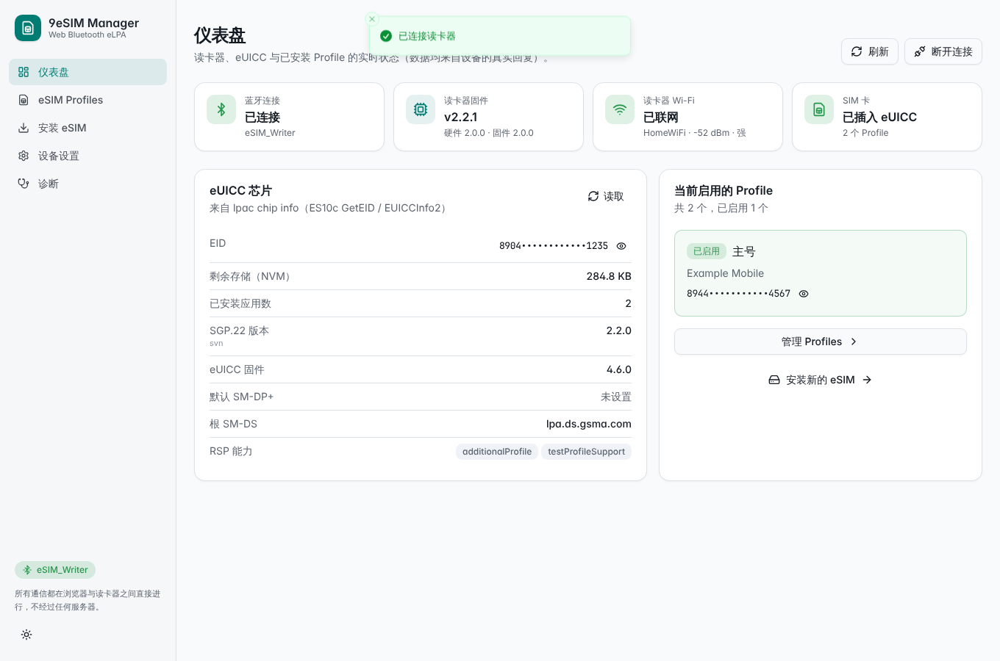
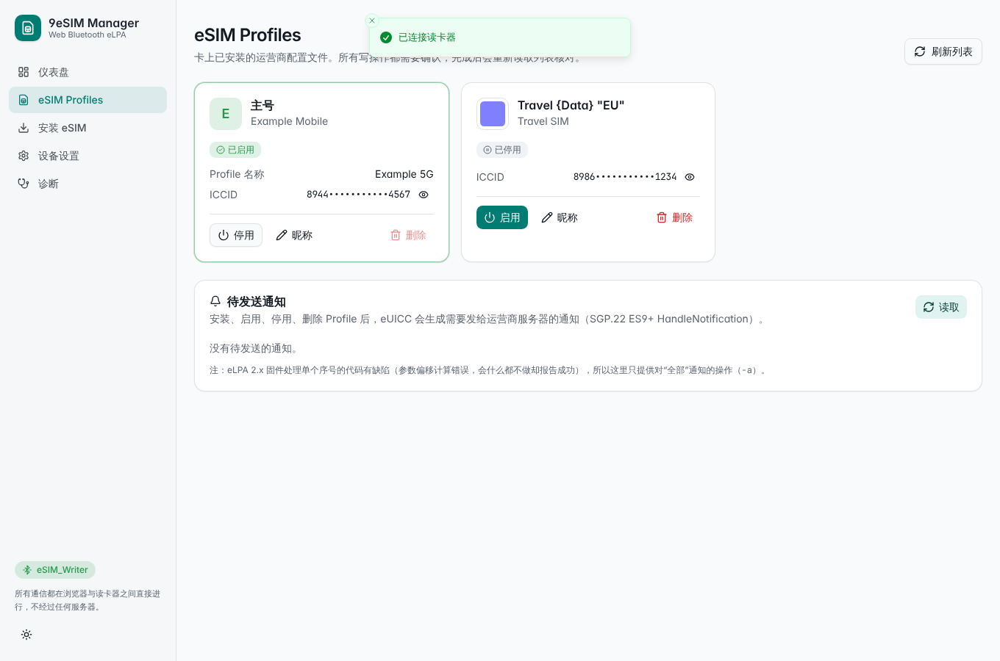
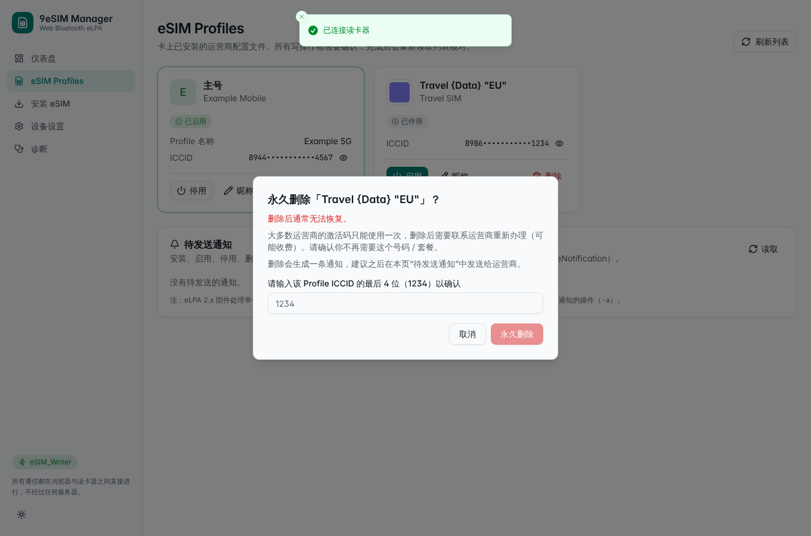
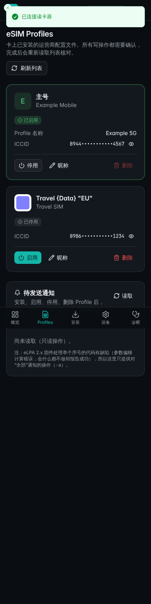

# 9eSIM Web Manager

用浏览器的 **Web Bluetooth** 直接连接旧款 9eSIM 蓝牙 eLPA 读卡器（`eSIM_Writer`），管理插在其中的
eUICC / eSIM 卡，不再依赖微信小程序。所有通信都在浏览器和读卡器之间进行，没有服务器、不需要安装驱动或浏览器扩展。



| Profiles | 删除确认 | 手机（深色） |
| --- | --- | --- |
|  |  |  |

> 截图中的数据来自自动化测试用的固件模拟器，不是真实设备。

## 使用入口

三种方式任选其一，功能完全相同：

| 方式 | 地址 / 操作 | 说明 |
| --- | --- | --- |
| **单文件（最简单）** | 下载 [`standalone/9eSIM-Web-Manager.html`](standalone/9eSIM-Web-Manager.html)，双击用 Chrome / Edge 打开 | 不需要安装任何东西。Chrome 把 `file://` 视为安全上下文。适合 Windows / macOS / Linux 桌面；Android 请用网页地址 |
| **网页地址** | https://callaumyan-design.github.io/dsh/esim-manager/ | 需要仓库开启 GitHub Pages（Settings → Pages → Source 选 *GitHub Actions*），并合并到 `main` 后自动部署。手机（Android Chrome）用这个 |
| **本地开发服务器** | `cd esim-manager && npm install && npm run dev`，打开 http://localhost:5173 | 需要 Node.js 20+ |

打开后点击“连接读卡器”，在弹窗中选择 `eSIM_Writer`。

连接成功后，应用只会自动发送三条 **只读** 命令：`{"cmd":"getElpaInfo"}`、`lpac chip info`、`lpac profile list`
（可以在“设备设置”中关闭）。任何写操作都需要你点击并二次确认。

> 不能嵌入到别的网页里使用：Chrome 禁止跨源 iframe 调用 Web Bluetooth，应用检测到时会提示在新标签页打开。

## 浏览器支持

Web Bluetooth 只能在 **安全上下文** 中使用：`https://` 或 `http://localhost`。用局域网 IP（如 `http://192.168.x.x`）访问不行。

| 环境 | 支持 |
| --- | --- |
| Windows / macOS / ChromeOS 上的 Chrome、Edge | ✅ |
| Android 上的 Chrome | ✅ |
| Linux 上的 Chrome | ⚠️ 可能需要打开 `chrome://flags/#enable-experimental-web-platform-features` |
| Brave | ⚠️ 需要在 `brave://flags/#brave-web-bluetooth-api` 启用 |
| Safari、Firefox | ❌ 不支持 Web Bluetooth |
| iOS / iPadOS 上的任何浏览器 | ❌ 都是 WebKit 内核 |

应用会检测实际支持情况；不支持时明确显示原因，不会假装已连接。

## 功能与验证状态

“源码核对”= 已逐行对照官方 eLPA 固件源码实现，并通过基于源码行为的 Mock BLE 测试；
**尚未在真实读卡器上验证**。请按 [docs/DEVICE-TESTING.md](docs/DEVICE-TESTING.md) 实机测试。

| 功能 | 状态 | 说明 |
| --- | --- | --- |
| 扫描并连接 `eSIM_Writer`，发现 NUS 服务与 RX/TX 特征，订阅通知 | ✅ 实测通过 | 名称过滤 + “显示所有设备”回退 |
| 断开检测、手动重连、撤销授权、资源释放 | 源码核对 · 待设备验证 | 断开时中止在途操作，写操作标记“结果未知”，不自动重试 |
| 协议识别（只读 getElpaInfo） | ✅ 实测通过 | 不会自动发送 APDU 等未经验证的命令 |
| 读卡器信息、Wi-Fi 状态 | ✅ 实测通过（Wi-Fi 联网检查） | 设备会明文返回 Wi-Fi 密码，本应用显示与记录前脱敏 |
| 插卡检测 | 源码核对 · 待设备验证 | V2.2.1 回复 cardStatus；V2.1.0 通过 euicc_init 错误推断 |
| EID、EUICCInfo2（容量、SGP.22 版本、能力等） | 源码核对 · 待设备验证 | `lpac chip info` |
| Profile 列表 | 源码核对 · 待设备验证 | `lpac profile list`，含图标 |
| 启用 / 停用 / 删除 / 修改昵称 | 源码核对 · 待设备验证 | 全部二次确认；删除需输入 ICCID 后 4 位；完成后自动重新读取 |
| 激活码下载安装、进度显示 | 实测：命令、进度、错误解析正常；写入卡片在部分卡上失败（固件问题，见“已知问题”） | 下载前检查读卡器 Wi-Fi；用 `-s/-m/-c` 传参；失败后自动只读核对 Profile 与通知 |
| 二维码导入激活码：拖入图片、选择图片、Ctrl+V 粘贴截图、摄像头扫描 | 已实现（浏览器测试通过） | 在本机解码（BarcodeDetector，Windows/Linux 退回 jsQR），图片与画面不上传；支持透明背景、反色、包在 Apple `esimsetup` 链接里的激活码。摄像头只用虚拟摄像头测过 |
| 通知列表 / 发送全部 / 移除全部 | 源码核对 · 待设备验证 | 固件按序号处理的代码有缺陷，只提供“全部” |
| SM-DS 发现 | 源码核对 · 待设备验证 | `lpac profile discovery` |
| 设置读卡器 Wi-Fi | 源码核对 · 待设备验证 | 固件不回复，随后轮询确认 |
| 诊断：环境、GATT、分片统计、只读控制台、日志导出、错误追踪 | 已实现 | 日志只在内存中，导出前已脱敏 |
| USB 串口日志（Web Serial，读取固件输出的 APDU 调试日志） | 已实现 · 待设备验证 | 桌面 Chrome / Edge；APDU 只保留指令头和状态字，密码、激活码参数、EID 已隐藏；自动标出异常状态字 |
| APDU JSON 协议（NekokoLPA 风格） | 只读，待设备验证 | 官方固件不支持；仅手动选择后使用 |
| 固件 OTA | 不提供 | 源码中的更新地址是占位符，无法核实，见“设备设置”页说明 |
| `chip purge`、修改默认 SM-DP+ | 不提供 | 风险过高 |

## 真实设备测试记录

| 日期 | 设备 | 结果 |
| --- | --- | --- |
| 2026-11-23 | 9eSIM 读卡器（eLPA 2.x 固件）+ 用户的 eUICC 卡，桌面版 Chrome | ✅ 蓝牙连接、协议识别、读取读卡器 Wi-Fi 状态、下载命令格式（`lpac profile download -s … -m …`）、9 步进度消息与错误消息解析均正常。❌ 下载停在第 7 步 `es10b_load_bound_profile_package`，报 `unknown,unknown`；**微信小程序同样失败**；同一张卡、同一个激活码在 **安卓手机 EasyEUICC 中安装成功** |

结论：这次失败与本应用无关，也不是卡片或 Profile 的问题，而是 eLPA 2.x 固件写入 Profile 包的环节（固件内置的旧版 lpac + ESP32 的 ISO 7816 T=0 驱动）。
本应用无法从浏览器修正固件内部的这段流程。可以用“诊断 → USB 串口日志”记录读卡器输出，定位失败的 APDU 与状态字。

## 已知问题

- **部分 eUICC / Profile 组合下载时在第 7 步失败（`unknown,unknown`）**：见上表。临时办法：用安卓手机（EasyEUICC / OpenEUICC）或 PC/SC 读卡器下载，再插回本读卡器用本应用管理。
  `unknown,unknown` 的含义（依据 `src/euicc/es10b.c`）：固件没有拿到卡片返回的 ProfileInstallationResult，只会在 APDU 传输出错、卡片返回非 9000/61xx 状态字、或回复无法解析时出现。

## 重要的协议事实

详细内容与源码出处见 [docs/PROTOCOL.md](docs/PROTOCOL.md)。

- **CLI 命令必须带程序名前缀**：固件把第一个词当作 argv[0]（程序名），发送 `chip info` 不会有任何蓝牙回复；正确的是 `lpac chip info`。
- **单条命令 ≤ 255 字节，一次写完**：固件把每次写入按 256 字节切开、逐包当作独立命令执行，不重组。超长命令会被拒绝发送，不截断。
- **回复按 256 字节分段通知，没有分隔符**：应用用增量 JSON 解析器重组，并利用“中间分片必须是 256 字节”检测 MTU 截断。
- **需要 ATT MTU ≥ 259**：网页无法设置 MTU。若诊断页显示最大分片小于 256，长回复会被截断，界面会给出提示。
- 官方 V2.x 固件 **不支持** NekokoLPA 的 `{"cmd":"APDU"}` 协议（已对照源码与发布的固件二进制）。

## 安全设计

- 页面加载、连接时不发送任何写入命令；写操作必须由用户点击并确认。
- 同一时间只执行一个操作；进行中的写操作会提示“请勿断开”。
- 蓝牙断开时中止在途操作；写操作结果标记为未知，提示用户核对，**绝不自动恢复或重试**。
- 删除前明确提示不可恢复，并要求输入 ICCID 后 4 位。
- EID、ICCID 默认脱敏显示，点击后显示 30 秒；激活码、确认码、Wi-Fi 密码不写日志、不保存。
- 日志写入前做结构化 + 正则双重脱敏；原始通知分片只记录长度（敏感字段可能跨分片，无法逐片脱敏）。
- 不使用 localStorage 保存任何设备数据（只保存主题偏好）。
- 不上传任何数据；不绕过 SM-DP+ 证书校验或任何授权流程。

## 架构

```
src/
├── lib/
│   ├── ble/            Web Bluetooth 传输层（设备选择、GATT、写入队列、断开、重连）与环境检测
│   ├── protocol/
│   │   ├── stream.ts   通知流 → JSON 消息的增量解析器（UTF-8 重组、多消息拆分、截断检测）
│   │   ├── messages.ts 设备消息分类
│   │   ├── redact.ts   脱敏
│   │   ├── legacy/     旧版 eLPA 适配器：JSON 控制命令 + lpac CLI（命令表附源码出处）
│   │   └── apdu/       APDU JSON 适配器（只读）与 BER-TLV 解析
│   ├── euicc/          统一业务接口 EuiccService、类型、激活码解析、回复解析
│   ├── session/        会话控制器：串联以上各层、维护 UI 状态、执行安全约束
│   └── log/            内存日志
├── components/         shadcn/ui 组件与业务组件
├── pages/              仪表盘、Profiles、安装、设备设置、诊断
└── test/               固件模拟器与伪 Web Bluetooth（仅测试）
```

新增读卡器时：实现一个新的适配器（参考 `LegacyElpaAdapter` / `ApduJsonAdapter`），再实现 `EuiccService`，
在 `SessionController.activate()` 中注册即可，界面不需要改动。

## 开发命令

```bash
npm run dev        # 开发服务器（localhost:5173）
npm run typecheck  # TypeScript 类型检查
npm test           # 单元测试 + Mock BLE 集成测试（Vitest）
npm run e2e        # 界面端到端测试（Playwright + 注入的 Mock BLE）
npm run build      # 类型检查 + 生产构建，输出到 dist/
npm run build:single  # 单文件构建，输出到 standalone/9eSIM-Web-Manager.html
npm run check      # typecheck + test + build
```

生产部署：把 `dist/` 放到任意 **HTTPS** 静态主机即可（使用相对路径，可部署在子目录）。
本仓库的 `.github/workflows/quadrant-pages.yml` 会在 `main` 更新时把它和四象限一起发布到 GitHub Pages 的 `/esim-manager/`。

## 致谢与许可

- 协议依据 [9esim/eLPA](https://github.com/9esim/eLPA)（MIT；其中 lpac 移植部分遵循 lpac 的许可）与
  [9esim/MiniToolFirmware](https://github.com/9esim/MiniToolFirmware)。
- APDU JSON 协议参考 [iebb/NekokoLPA](https://github.com/iebb/NekokoLPA)（MIT）。
- 二维码解码使用 [jsQR](https://github.com/cozmo/jsQR)（Apache-2.0），作为运行时依赖打包进应用。
- ES10x 命令依据 GSMA SGP.22，并与 [estkme-group/lpac](https://github.com/estkme-group/lpac) 交叉核对。
- 除上面列出的运行时依赖外，本项目没有复制上述项目的源代码。本项目代码以 MIT 许可发布。
- 与 9eSIM 官方无关联。
