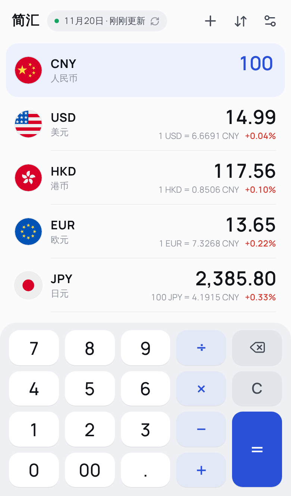
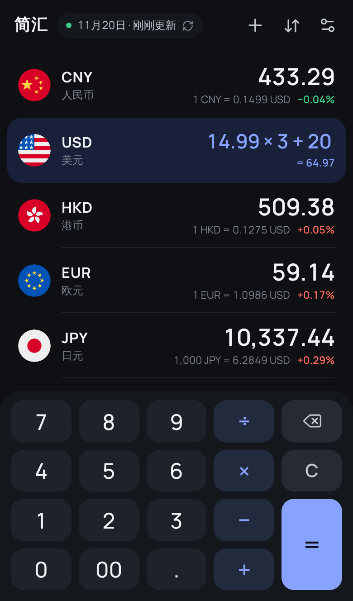
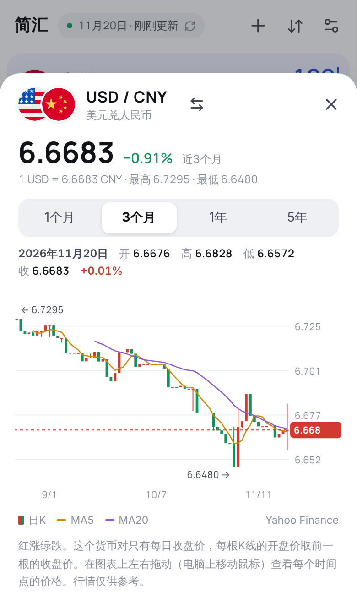

# 简汇 · 多币种汇率对比

输入一种货币的金额，列表里的其他货币同时换算出来。每一行还会给出单位汇率和当天涨跌，可以直接在键盘上算 `100 × 3 + 25`。向左滑一行看它的走势 K 线，向右滑换成别的货币，长按后上下拖动调整顺序。手机和电脑都能用，可以装到主屏幕，断网也能打开。

**在线使用：<https://huilv.botian-yan.workers.dev>**

| 浅色 | 深色（连续计算） | 左滑看走势 K 线 |
| --- | --- | --- |
|  |  |  |

## 功能

- **一屏对比**：点任意一行把它设为输入货币，金额会按当前换算值带过去；其他行实时换算
- **行数随屏幕变化，不用滚动**：按列表区域的高度算出能放几行（每行至少 64 像素），几行等分填满，行越高字号越大。比如 iPhone SE 浏览器里 4 行、Pixel 7 7 行、电脑上 5～8 行。放满后再添加会替换最后一行；排在后面放不下的货币不会删掉，换到更高的屏幕上会显示出来（编辑模式里标着“放不下”）
- **单位汇率**：每行下方显示“1 USD = 6.6691 CNY”。数值太小的货币自动换单位，比如“100 JPY = 4.19 CNY”“10,000 VND = 2.59 CNY”
- **当天涨跌**：和前一天比的涨跌幅，红涨绿跌
- **计算器键盘**：+ − × ÷ 连续计算（先乘除后加减），`=` 得出结果，`00` 快速输入整数
- **左滑看走势**：向左滑一行，打开这种货币相对当前输入货币的 K 线（比如输入人民币时左滑美元，看的是美元兑人民币）。可选 1 个月、3 个月（日K）、1 年（周K）、5 年（月K），带 MA5 / MA20 均线、区间涨跌和最高最低价；在图上左右拖动查看每一根的开高低收；点 ⇄ 反转货币对
- **右滑更换**：向右滑一行，直接把它换成别的货币；选的货币已经在列表里时，两行交换位置
- **长按拖动排序**：长按一行约 0.3 秒，行会浮起来，接着上下拖动调整顺序，靠近列表边缘时会自动滚动
- **复制**：长按后不移动直接松手（电脑上右键）复制金额；电脑上 `Ctrl/⌘ + C` 复制当前输入货币的金额
- **跟手**：滑动 1:1 跟随手指，快速一甩也能触发，没滑到位会弹回
- **61 种货币**：常用货币、黄金/白银（每盎司）、比特币/以太坊，以及东南亚、中东、欧洲、拉美等地货币。搜索支持代码（usd）、中文（美元）、拼音（meiyuan）、拼音首字母（my）、英文（dollar）、地区（迪拜）
- **整理列表**：编辑模式下用把手拖动排序、移除货币
- **小数位数**：自动 / 0 / 2 / 4。自动模式下一般保留两位，小于 1 的金额保留四位有效数字
- **浅色 / 深色 / 跟随系统**
- **离线可用**：汇率保存在本机；完全没有网络时使用应用内置的汇率，顶部会标明“内置数据”

### 电脑键盘

| 按键 | 作用 |
| --- | --- |
| 数字、`.` | 输入 |
| `+` `-` `*`（或 `x`）`/` | 运算 |
| `Enter` 或 `=` | 计算结果 |
| `Backspace` | 退格 |
| `Esc` / `Delete` / `C` | 清零 |
| `↑` `↓` | 切换输入货币 |
| `←` | 查看当前输入货币的走势（同左滑） |
| `→` | 更换当前输入货币（同右滑） |

## 汇率数据

依次尝试下面几个来源，拿到第一份可用的数据为止：

1. 同源接口 `/api/rates`：部署在 Cloudflare 时由 Worker 提供，聚合下面的数据并在边缘缓存 1 小时
2. [fawazahmed0/exchange-api](https://github.com/fawazahmed0/exchange-api)（每日更新，含贵金属和加密货币），先走 jsDelivr，再走 Cloudflare Pages 镜像；同时取前一天的数据算涨跌
3. [ExchangeRate-API 开放接口](https://www.exchangerate-api.com/docs/free)（不含贵金属和加密货币，没有涨跌）
4. 本机上次保存的汇率
5. 应用内置的快照（`src/data/snapshot.json`）

打开应用、切回前台、恢复联网时会检查汇率，一小时内更新过就不再请求。点顶部的日期可以手动更新。

### 走势 K 线

1. [Yahoo Finance](https://finance.yahoo.com) 的历史行情，由 Worker 请求（浏览器直接请求会被跨域限制挡住），日K缓存 15 分钟、周K和月K缓存 6 小时。没有直接报价的货币对（比如新台币兑越南盾、黄金兑人民币）经美元换算；黄金、白银用 COMEX 期货价格
2. 欧洲央行每日参考汇率（[Frankfurter](https://frankfurter.dev)），约 30 种货币
3. fawazahmed0 每日汇率，按日期抽样

Yahoo 的不少外汇日线只有一个价格（开高低收相同），后两个来源也只有每天一个价格。这种情况下每根 K 线的开盘价取前一根的收盘价（外汇 24 小时交易，当天开盘价约等于前一天收盘价），走势面板底部会注明。看过的走势会保存在本机，离线时也能看到上次的数据。

这些都是参考用的市场中间价，和银行、换汇机构的实际买入卖出价会有差别。

## 使用方式

### 1. 在线版

打开 <https://huilv.botian-yan.workers.dev>。手机浏览器里选“添加到主屏幕”，电脑上的 Chrome / Edge 点地址栏右侧的安装图标，或在 设置 → 安装 里操作。

### 2. 单文件版

下载 [`standalone/简汇汇率.html`](standalone/简汇汇率.html)，双击用浏览器打开即可，有网络时同样会获取实时汇率。

### 3. 自己部署

需要 Node.js 20 或更高版本。

```bash
cd huilv
npm install
npm run dev             # 开发服务器 http://localhost:5173
npm test                # 单元测试
npm run e2e             # 端到端测试（Playwright，电脑 + 手机）
npm run build           # PWA 构建，输出到 dist/，可以放到任何静态托管
npm run build:artifact  # 单文件构建，更新 standalone/ 下的 HTML
npm run deploy          # 部署到 Cloudflare Workers（需要先 npx wrangler login）
npm run snapshot        # 更新内置汇率快照
```

`npm run deploy` 会把 `dist/` 里的文件嵌进 Worker 脚本（`scripts/worker-files.mjs`），一个 Worker 同时提供页面、`/api/rates` 和 `/api/history`。放在 GitHub Pages 等纯静态托管上也能用，这时浏览器会直接请求公开汇率接口，走势只能用欧洲央行和每日快照的数据。

## 目录结构

```
huilv/
├── src/
│   ├── lib/          # 纯逻辑：币种表与搜索、计算器、格式化、汇率与走势数据（含单元测试）
│   ├── components/   # 行（左右滑动）、键盘、选择货币、走势 K 线、设置、弹出面板
│   ├── data/         # 内置汇率快照、圆形国旗雪碧图（自动生成）
│   └── styles/       # 样式与浅色/深色主题
├── worker/           # Cloudflare Worker：页面 + /api/rates + /api/history
├── e2e/              # Playwright 端到端测试
├── public/           # 图标
├── scripts/          # 图标、国旗、快照生成，单文件构建，Worker 打包
└── standalone/       # 可直接双击打开的单文件版本
```

## 开源致谢

- [React](https://react.dev) + TypeScript + [Vite](https://vite.dev)
- [circle-flags](https://github.com/HatScripts/circle-flags)（MIT）：圆形国旗，合成一张雪碧图使用
- [dnd-kit](https://dndkit.com)（MIT）：拖动排序
- [Zustand](https://github.com/pmndrs/zustand)（MIT）：状态管理
- [Lucide](https://lucide.dev)（ISC）：图标
- [vite-plugin-pwa](https://vite-pwa-org.netlify.app)（MIT）/ Workbox：离线与安装
- [Manrope](https://github.com/sharanda/manrope)（SIL OFL 1.1）：数字与英文字体，许可证见 `src/assets/fonts/MANROPE-OFL.txt`
- 汇率数据：[fawazahmed0/exchange-api](https://github.com/fawazahmed0/exchange-api)（CC0）、[ExchangeRate-API](https://www.exchangerate-api.com)
- 走势数据：Yahoo Finance、欧洲央行参考汇率（经 [Frankfurter](https://frankfurter.dev)），仅供个人参考
