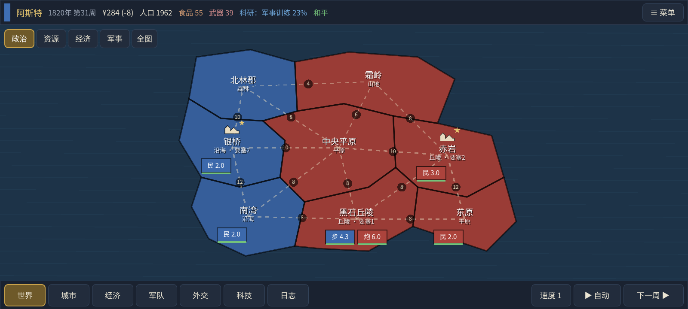
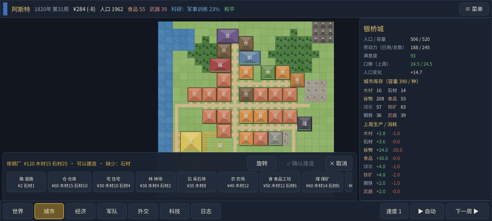
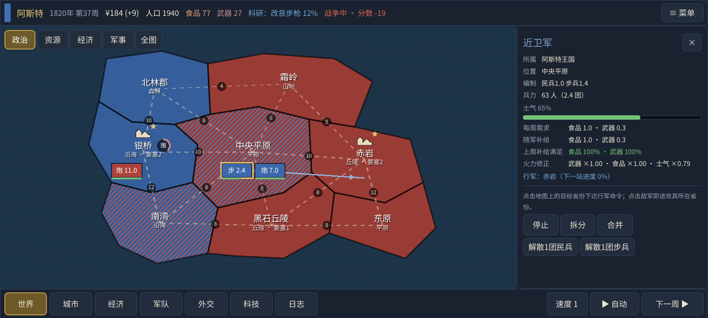
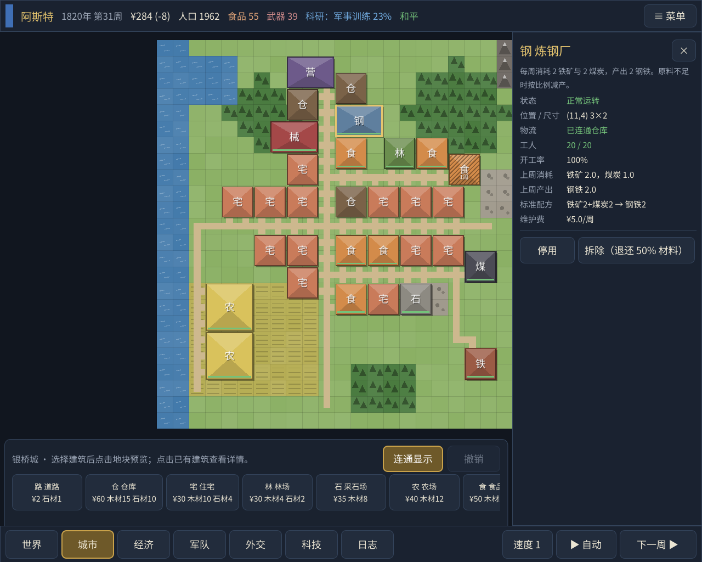
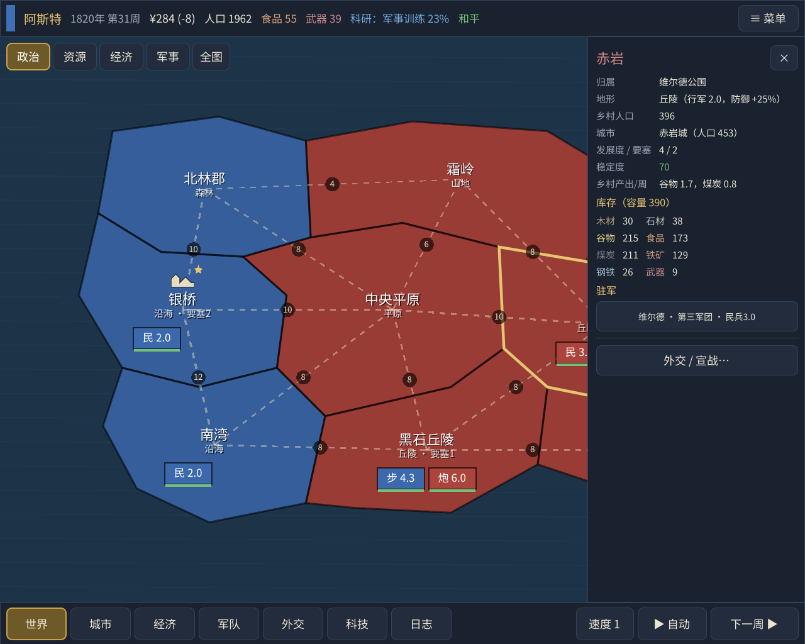

# 工业与帝国（Industry & Empire）

Android 离线单机大战略 + 城市建造游戏（Godot 4.7 / GDScript）。原创世界观、原创数据与界面。

城市建设与国家战争同等重要：你在 24×24 地块上规划首都的道路、仓库、住宅与产业链，
把钢铁和武器沿有容量限制的省际道路送上前线，同时与一个独立运行的 AI 国家竞争——
可以靠工业、贸易、外交或军事取胜。





| 折叠屏（地图 + 详情面板并排） | |
|---|---|
|  |  |

## 当前版本内容（MVP v0.1.0）

| 项目 | 数量 |
|---|---|
| 战略省份 | 8（固定邻接图，带运输容量的省际道路） |
| 国家 | 2 个可选国家 + 中立部落 |
| 可精细建设城市 | 2（各 24×24 地块） |
| 资源 | 8：木材 石材 谷物 食品 煤炭 铁矿 钢铁 武器 |
| 建筑 | 12：道路 仓库 住宅 林场 采石场 农场 食品工坊 煤矿 铁矿 炼钢厂 兵工厂 兵营 |
| 兵种 | 3：民兵 步兵 炮兵 |
| 科技 | 8（经济 / 工业 / 军事三条分支） |
| AI 国家 | 1（规则驱动的 Utility AI，与玩家使用同一套命令与成本） |
| 胜负 | 经济胜利、军事胜利（攻占首都迫降）、综合霸权；首都沦陷、长期破产崩溃 |

完整说明见游戏内“游戏说明”。

## 目录结构

```
industry-empire/
├── project.godot / export_presets.cfg / icon.svg
├── data/                 # 全部数值配置（JSON）：资源、建筑、兵种、科技、地形、平衡、AI、场景
├── src/core/             # 领域数据结构：GameState Nation Province City Building Army 等
├── src/systems/          # 与画面无关的模拟系统（经济、物流、军事、战斗、外交、科技、AI、回合、存档）
├── src/autoload/session.gd   # 会话：持有 GameState、周推进、自动存档、后台暂停
├── src/ui/               # 界面（纯代码构建 + 自绘地图）
├── scenes/main.tscn      # 入口场景
├── tests/                # 无头自动化测试（tests/unit/*.gd）与 UI 冒烟测试
├── tools/                # 测试/检查/平衡模拟/截图脚本
├── assets/fonts/         # 内置中文字体（Noto Sans SC 子集，OFL）
└── docs/screenshots/
```

设计说明：[ARCHITECTURE.md](ARCHITECTURE.md) · 路线图：[PLAN.md](PLAN.md) · 进度与已知问题：[PROGRESS.md](PROGRESS.md)

## 运行与测试（桌面）

需要 Godot 4.7.x 标准版（非 .NET）。

```bash
# 在编辑器中打开：godot -e --path industry-empire
# 直接运行：
godot --path industry-empire

# 自动化测试（45 项，约 50 秒）
GODOT=/path/to/godot industry-empire/tools/run_tests.sh
# UI 冒烟测试（驱动真实界面走完整流程）
godot --headless --path industry-empire res://tests/ui_smoke.tscn
# AI 对 AI 平衡模拟：种子 3，最多 200 周
godot --headless --path industry-empire -s res://tools/simulate.gd -- 3 200
```

## 构建 Android APK

本项目使用 Godot 自带的预编译 APK 模板导出（不需要 Gradle / Android Studio）。

1. 安装 Godot 4.7.2 与对应的 **Export Templates**（编辑器：编辑器 → 管理导出模板 → 下载）。
2. 准备 Android SDK（需要 `platform-tools/adb` 与 `build-tools/<版本>/apksigner`）以及 JDK 17+。
3. 在 编辑器设置 → 导出 → Android 中填写 Android SDK 路径、Java SDK 路径和调试密钥库
   （可用 `keytool -genkeypair -keystore debug.keystore -storepass android -alias androiddebugkey -keypass android -keyalg RSA -validity 10000 -dname "CN=Android Debug,O=Android,C=US"` 生成）。
4. 导出：

```bash
cd industry-empire
mkdir -p build
# 通用调试包（arm64-v8a + armeabi-v7a + x86_64）
godot --headless --path . --export-debug "Android" build/industry-empire-debug.apk
# 仅 arm64 的发布包（正式发布请换成你自己的发布密钥库）
GODOT_ANDROID_KEYSTORE_RELEASE_PATH=/path/release.keystore \
GODOT_ANDROID_KEYSTORE_RELEASE_USER=<alias> GODOT_ANDROID_KEYSTORE_RELEASE_PASSWORD=<password> \
godot --headless --path . --export-release "Android arm64" build/industry-empire-0.1.0-arm64.apk
```

5. 安装：`adb install -r build/industry-empire-0.1.0-arm64.apk`

导出配置未申请任何 Android 权限（包括 INTERNET），游戏在飞行模式下完全可玩。
存档写在应用私有目录 `user://saves/`。

## 操作

- 单指拖动平移地图，双指缩放（桌面：滚轮）。
- 世界地图：点省份查看详情；点己方部队选中，再点目标省份即行军；点敌军即进攻其所在省份。
- 城市：底部选择建筑 → 点击地块预览（绿色可建 / 红色不可建并显示原因）→ “旋转”/“确认建造”；道路点起点和终点铺设 L 形路线；“撤销”可全额退回本周的建造。
- 底栏：世界 / 城市 / 经济 / 军队 / 外交 / 科技 / 日志；“下一周”手动推进，“自动”连续推进，“速度”切换三档。
- Android 返回键：关闭面板 → 取消建造 → 取消选择 → 打开菜单。

## 许可

代码与数据为本项目原创。内置字体为 Noto Sans CJK SC 的子集，遵循 SIL Open Font License 1.1（见 `assets/fonts/OFL.txt`）。
