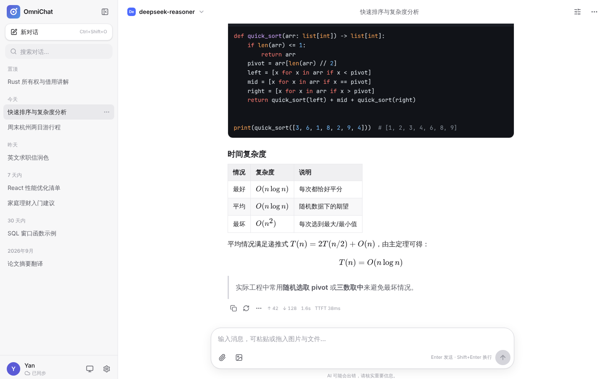
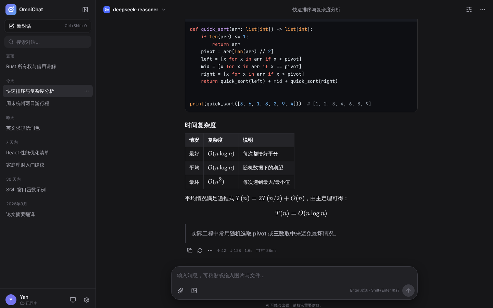
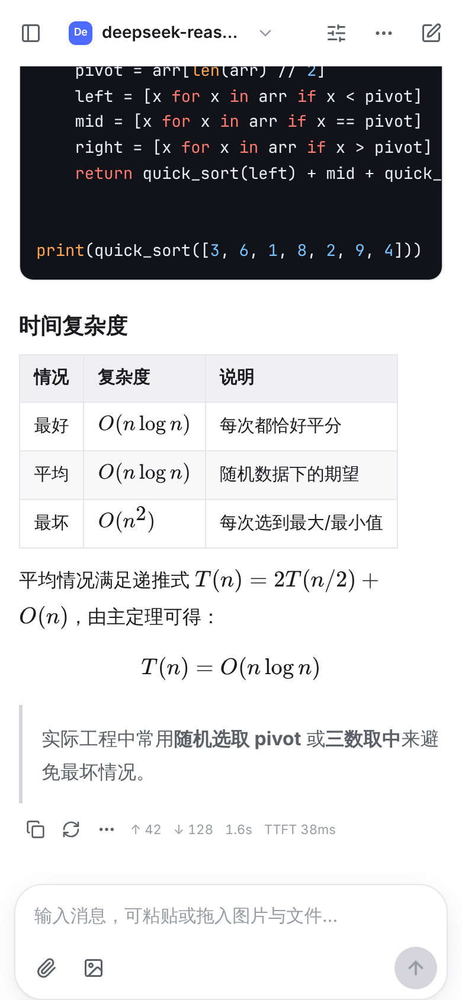
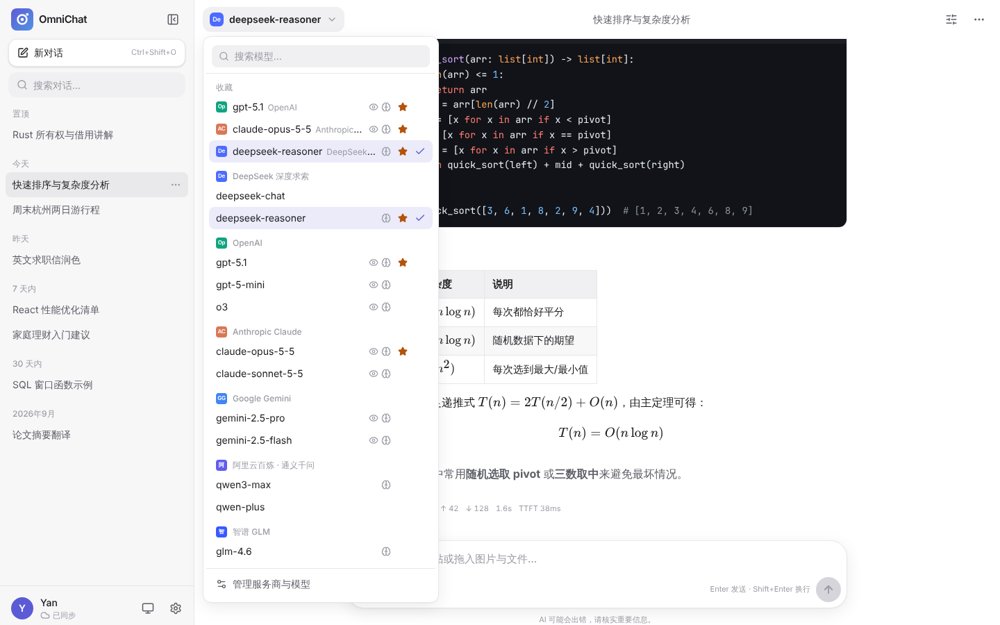
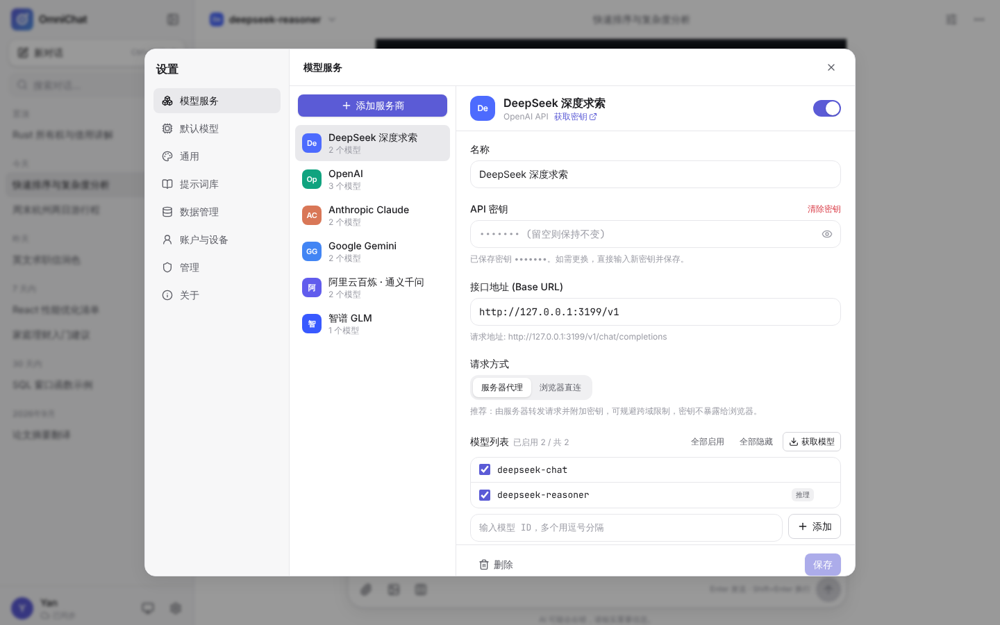
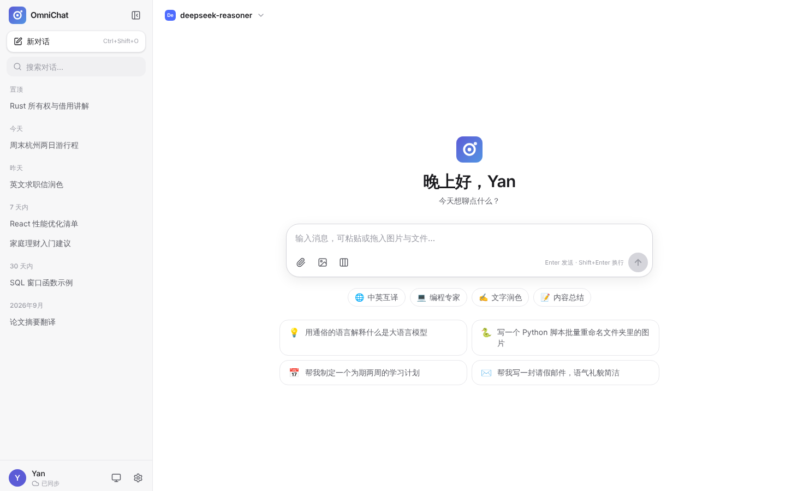

# OmniChat

一个可自托管的多模型 AI 聊天网页应用：**一个入口调用所有主流大模型 API，对话与设置保存在你自己的服务器上，电脑、手机、平板多设备实时同步。**

| 桌面端（浅色） | 桌面端（深色） | 手机端 |
| --- | --- | --- |
|  |  |  |
| **模型切换（跨服务商、收藏）** | **服务商设置** | **欢迎页** |
|  |  |  |

## 功能

**多模型、多接口**
- 原生支持三大协议：**OpenAI Chat Completions**、**Anthropic Messages（Claude）**、**Google Gemini**，绝大多数厂商都通过这三种协议之一接入。
- 内置 25+ 预设：OpenAI、Claude、Gemini、DeepSeek、通义千问（阿里云百炼）、Kimi、智谱 GLM、豆包（火山方舟）、硅基流动、百度千帆、腾讯混元、MiniMax、阶跃星辰、OpenRouter、xAI Grok、Mistral、Groq、Together、Perplexity、GitHub Models、Azure OpenAI、Ollama、LM Studio，以及任意「OpenAI / Anthropic / Gemini 兼容」的自定义接口（中转站、自建网关等）。
- 一键「获取模型」列表、「测试连接」，可自由启用/隐藏模型、收藏常用模型。
- 推理模型支持：统一的「思考强度」设置，自动映射为各家参数（OpenAI `reasoning_effort`、Claude 自适应思考 / `budget_tokens`、Gemini `thinkingConfig`、通义 `enable_thinking`、GLM/豆包 `thinking`、OpenRouter `reasoning`）；思考过程可折叠显示，兼容 `reasoning_content` 字段与 `<think>` 标签。
- 每个服务商可设置自定义请求头和「额外请求体」JSON，覆盖任何厂商特有参数（值为 `null` 可删除字段）。
- **多模型同时回答**：一个问题同时发给最多 6 个模型（可跨服务商）并行生成，用标签页切换对比，选中的回答作为后续上下文。
- **联网搜索**：一键开启服务商自带的搜索能力（Claude `web_search`、Gemini Google 搜索、通义 `enable_search`、智谱 `web_search`、OpenRouter web 插件、文心 / 混元搜索、OpenAI Responses `web_search`），回答下方列出参考来源。
- OpenAI 可切换到 **Responses API**，获得推理摘要、内置联网搜索以及仅在该接口提供的模型。

**多设备同步与数据保存**
- 账户体系：首个注册用户为管理员，可开放/关闭注册、管理用户；每个账户数据隔离。
- 对话、消息、服务商配置、提示词、个人设置全部保存在服务端数据库，任一设备登录即可继续对话。
- 本地 IndexedDB 缓存 + 离线写入队列：打开即显示、断网可查看历史，恢复网络后自动同步。
- API 密钥使用 AES-GCM 加密存储，默认由服务器代理调用，浏览器拿不到明文密钥。
- 全文搜索历史消息、导出备份（JSON / Markdown）、导入备份及 **ChatGPT 导出的 conversations.json**。
- 设备管理：查看所有已登录设备并可远程下线。

**好用的界面**
- 参考 ChatGPT / Claude 的简洁设计，亮色/暗色/跟随系统，8 种强调色，3 档字号，中英文界面。
- Markdown、代码高亮（一键复制、换行切换）、表格、LaTeX 公式、Mermaid 图表、HTML 代码块实时预览。
- 流式输出、随时停止、重新生成（保留多个版本可切换）、编辑后重新发送、从任意消息创建分支对话、朗读。
- 图片（粘贴/拖拽/上传，自动压缩）、PDF、各类文本/代码文件作为附件。
- 每个对话可单独设置系统提示词、温度、Top P、最大 Token、上下文条数、思考强度等；可保存为新对话默认值。
- 提示词库（内置 10 个常用角色模板）、自动生成对话标题、置顶、分组（今天/昨天/7 天内…）。
- 移动端适配 + PWA，可「添加到主屏幕」像 App 一样使用。
- 快捷键：`Ctrl/⌘+Shift+O` 新对话、`Ctrl/⌘+K` 搜索、`Ctrl/⌘+,` 设置、`Ctrl/⌘+Shift+S` 侧边栏。

## 部署

任选一种方式。部署完成后用浏览器打开，按提示创建管理员账户，然后在「设置 → 模型服务」中添加服务商并填写 API 密钥即可开始使用。其他设备打开同一网址并登录同一账户即可同步。

### 方式一：Docker（推荐，适合云服务器 / NAS / 家里常开的电脑）

```bash
git clone https://github.com/callaumyan-design/dsh.git
cd dsh/omnichat
docker compose up -d --build
```

访问 `http://服务器IP:3000`。数据保存在 `./data` 目录（`omnichat.db` 数据库 + `secret.key` 密钥加密文件，请一起备份）。

> 手机等其他设备通过公网访问时，建议在前面加一层 HTTPS（Caddy、Nginx、Cloudflare Tunnel 等），并设置 `TRUST_PROXY=true`。HTTPS 下才能使用「添加到主屏幕」离线缓存等功能。

### 方式二：Cloudflare Workers（免费、无需服务器）

需要一个 Cloudflare 账号和本机 Node.js 22+。

```bash
cd omnichat
npm install
npx wrangler login
npx wrangler d1 create omnichat          # 把输出的 database_id 填入 wrangler.toml
npx wrangler secret put APP_SECRET       # 输入一串足够长的随机字符串，用于加密 API 密钥
npm run cf:deploy
```

部署完成后会得到一个 `https://omnichat.<你的子域>.workers.dev` 地址，可在 Cloudflare 后台绑定自己的域名。

> 说明：Workers 在离你最近的边缘节点发起 API 请求。如果某些服务商限制了所在地区，可把该服务商切换为「浏览器直连」模式，或改用 Docker 部署在合适地区的服务器上。

### 方式三：直接用 Node.js 运行（Windows / macOS / Linux）

需要 Node.js **22.13 或更高版本**。

```bash
cd omnichat
npm install
npm run build
npm start            # 默认端口 3000，数据保存在 ./data
```

同一局域网内的手机可以访问 `http://电脑的局域网IP:3000` 使用。

### 环境变量

| 变量 | 默认值 | 说明 |
| --- | --- | --- |
| `PORT` | `3000` | 监听端口（开发模式为 8787） |
| `HOST` | `0.0.0.0` | 监听地址 |
| `DATA_DIR` | `./data` | 数据目录（Docker 中为 `/data`） |
| `APP_SECRET` | 自动生成 | 加密 API 密钥用的密钥。未设置时自动生成并保存在 `DATA_DIR/secret.key` |
| `ALLOW_REGISTER` | `false` | 管理员创建后是否允许他人注册（也可在「设置 → 管理」中切换） |
| `TRUST_PROXY` | `false` | 位于反向代理之后时设为 `true`，用于正确识别客户端 IP（登录限流） |
| `ALLOW_PRIVATE_NETWORK` | `false` | 是否允许**非管理员**用户把接口地址指向内网地址（管理员始终允许） |
| `HTTPS_PROXY` / `HTTP_PROXY` / `NO_PROXY` | – | 服务器访问 AI 接口时使用的代理（如国内服务器访问 OpenAI） |
| `PASSWORD_ITERATIONS` | 300000（Workers 为 30000） | 密码哈希 PBKDF2 迭代次数 |

### 忘记密码

管理员可在「设置 → 管理」中为任何用户重置密码。如果唯一的管理员忘记了密码：

```bash
# Node / 本地运行
node dist/server/index.mjs reset-password admin 新密码
# Docker
docker exec omnichat node dist/server/index.mjs reset-password admin 新密码
```

## 使用说明

### 添加服务商

1. 打开「设置 → 模型服务 → 添加服务商」，选择对应厂商（找不到的选「自定义（OpenAI 兼容）」）。
2. 填写 API 密钥；如使用中转站/代理网关，修改「接口地址」（一般以 `/v1` 结尾）。
3. 点「保存」→「获取模型」勾选需要的模型 →「测试连接」确认可用。

### 服务器代理 vs 浏览器直连

- **服务器代理（默认，推荐）**：浏览器把请求发给你的 OmniChat 服务器，由服务器附加密钥后转发。无跨域问题，密钥不出服务器。
- **浏览器直连**：浏览器直接请求服务商接口，需要服务商允许跨域（CORS）。适合：
  - 运行在**你自己电脑上**的 Ollama / LM Studio（服务器访问不到你电脑的 `localhost`）。Ollama 需设置环境变量 `OLLAMA_ORIGINS=*` 后重启；
  - 服务器所在地区无法访问、而你本机可以访问的接口。

### 多模型对比与联网搜索

- 输入框下方的「多模型」按钮可勾选额外的模型，之后每条消息都会由当前模型和这些模型同时回答；点击回答上方的模型标签切换查看。
- 「联网」按钮只在当前服务商支持原生搜索时出现，开启后由服务商自行搜索并在回答下方给出来源链接。

### 思考强度

「对话设置 → 思考强度」对不同服务商自动转换参数。「默认」表示不发送该参数，由模型自行决定。部分模型不支持关闭思考或特定级别，若报错请改回「默认」。

### 导入 ChatGPT 历史

在 ChatGPT「设置 → 数据控制 → 导出数据」，解压后在 OmniChat「设置 → 数据管理 → 导入数据」选择 `conversations.json`。

## 工作原理

```
浏览器（React SPA，IndexedDB 缓存 + 离线写入队列）
   │  ① /api/sync、/api/messages  增量同步（每 20 秒 / 切回页面时）
   │  ② /api/proxy/<服务商>/…     流式转发，服务器附加密钥
   ▼
OmniChat 服务端（Hono；Node + SQLite 或 Cloudflare Workers + D1）
   │
   ▼
OpenAI / Claude / Gemini / DeepSeek / 通义 / …
```

- 服务端只做鉴权、存储和透明转发，各家协议的请求构造与流式解析都在浏览器端完成，因此服务端非常轻量，也能运行在 Workers 免费额度内。
- 同步采用「服务端为准、按更新时间增量拉取、本地修改先进入持久化队列」的方式；同一条数据在多端同时修改时以最后写入为准。

## 开发

```bash
npm install
npm run dev          # 前端 http://localhost:5173（自动代理 API 到 8787 端口的后端）
npm run typecheck
npm run build
```

端到端测试（使用内置的模拟 AI 服务器，无需真实密钥）：

```bash
node scripts/mock-ai.mjs 3199 &                      # 模拟 OpenAI / Anthropic / Gemini 流式接口
DATA_DIR=/tmp/omni PORT=3100 npm start &
node scripts/e2e.cjs http://localhost:3100 http://127.0.0.1:3199 ./screenshots
```

项目结构：

```
server/          服务端（Hono）：app.ts 路由、db-*.ts 存储适配、node.ts / worker.ts 两种入口
shared/          前后端共享的类型与鉴权工具
src/lib/ai/      各协议适配器（openai / anthropic / gemini）与服务商预设
src/lib/sync.ts  同步引擎（离线队列 + 增量拉取）
src/store/       状态管理（zustand）
src/components/  界面组件
```

## 许可

MIT
