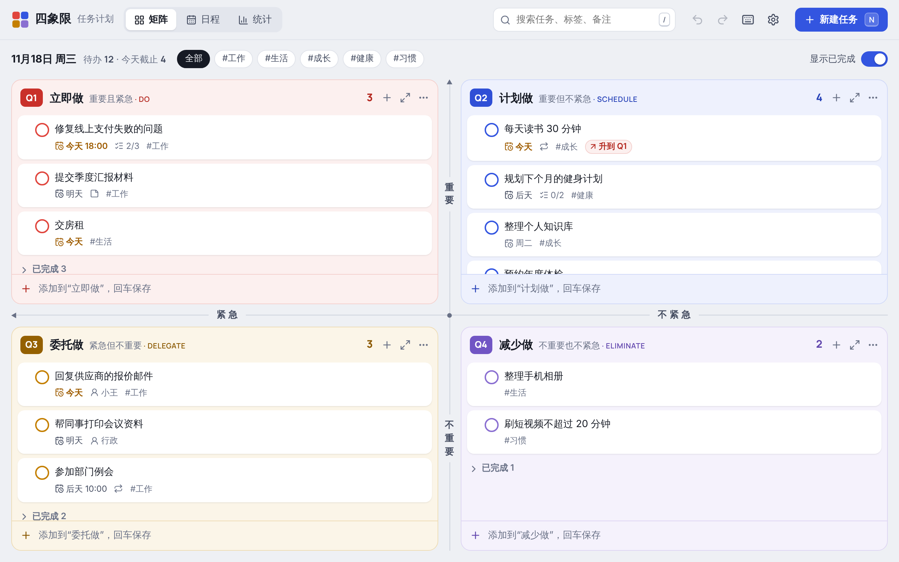
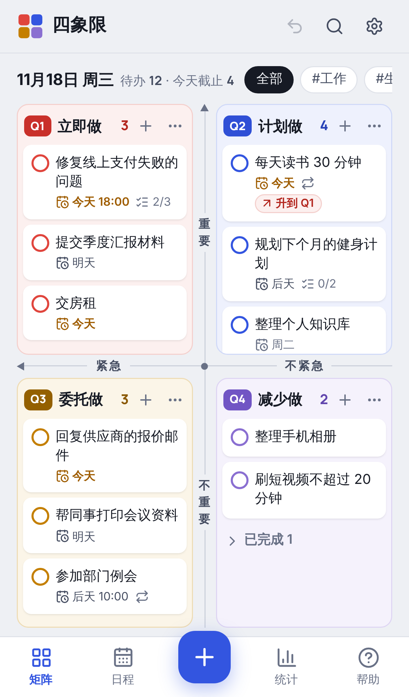
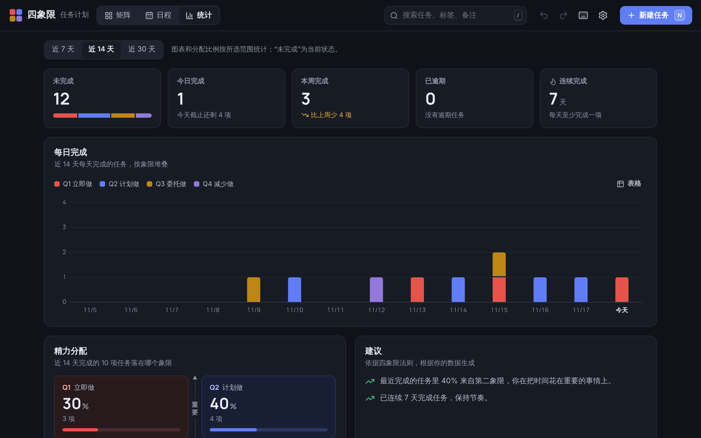

# 四象限 · 任务计划

按**重要程度**和**紧急程度**把事情分进四个象限（艾森豪威尔矩阵），用拖拽来整理优先级。可以直接在浏览器里用，也可以安装成手机或电脑上的应用，离线可用，数据只保存在你自己的设备上。



| 手机 | 统计（深色模式） |
| --- | --- |
|  |  |

## 四个象限

| 象限 | 含义 | 策略 |
| --- | --- | --- |
| **Q1** 重要且紧急 | 危机、临近截止的项目、突发问题 | **立即做**，亲自处理 |
| **Q2** 重要但不紧急 | 长期目标、学习成长、预防性工作 | **计划做**，排进日程 |
| **Q3** 紧急但不重要 | 打断、部分会议、别人的急事 | **委托做**，交给别人或批量处理 |
| **Q4** 不重要也不紧急 | 消遣、琐事、无意义的忙碌 | **减少做**，能删就删 |

## 功能

**整理任务**
- 2×2 矩阵，十字坐标轴画在四个象限中间：纵轴上方“重要”、下方“不重要”，横轴左边“紧急”、右边“不紧急”，每个标签正好落在它描述的两个象限之间
- 拖动卡片在象限之间移动、在象限内排序（电脑用鼠标，手机长按后拖动）
- 专注模式：放大一个象限，其他三个象限缩到侧边，仍然可以把任务拖进去
- 卡片菜单和键盘数字键 1–4 也能移动任务，不依赖拖拽
- 一键“按截止日期排序”、清除已完成

**添加任务**
- 每个象限底部都有输入框，回车即添加
- “新建任务”弹窗里用 2×2 选择器选象限
- 智能识别：输入“明天下午3点 写周报 #工作 @小李 !1”，会自动拆出日期、时间、标签、委托人和象限（可在设置中关闭）

**任务详情**
- 截止日期和时间、重复（每天 / 每个工作日 / 每周 / 每月）、委托给谁、标签、子任务清单、备注
- 重复任务完成后自动生成下一次
- **升级提醒**：第二象限的任务快到截止日时，卡片上出现“升到 Q1”按钮（提前天数可设置）

**其他视图**
- **日程**：按“已逾期 / 今天 / 明天 / 未来 7 天 / 更晚 / 未设日期”分组
- **统计**：未完成、今日完成、本周完成（与上周对比）、逾期、连续完成天数；每日完成柱状图（可切换表格）；“精力分配”矩阵显示完成的任务落在哪个象限；根据四象限法则给出建议；常用标签

**使用体验**
- 撤销 / 重做（删除、完成、移动、导入都能撤销）
- 搜索、按标签筛选
- 浅色 / 深色 / 跟随系统
- 适配手机：四宫格布局、底部导航、底部弹出面板
- PWA：可“安装”到桌面或手机主屏幕，断网也能打开
- 导出 JSON 备份、导入（合并或替换）、复制为 Markdown 清单
- 多个标签页之间自动同步

## 使用方式

### 1. 直接打开（最简单）

下载 [`standalone/四象限任务计划.html`](standalone/四象限任务计划.html)，双击用浏览器打开即可，不需要网络和安装。数据保存在这个浏览器里。

### 2. 部署成网站 / 安装成应用

仓库里带有 GitHub Pages 部署流程（`.github/workflows/quadrant-pages.yml`）：

1. 在 GitHub 仓库的 **Settings → Pages** 中，把 **Source** 设为 **GitHub Actions**
2. 把代码合并到 `main` 分支（或在 Actions 页面手动运行 “部署四象限任务计划”）
3. 部署完成后访问 `https://<你的用户名>.github.io/<仓库名>/`
4. 手机浏览器打开后选择“添加到主屏幕”，电脑上的 Chrome / Edge 点地址栏的安装图标，或在应用的 设置 → 安装 中操作

也可以把 `npm run build` 生成的 `dist/` 目录放到任何静态网站托管服务上（需要 HTTPS 才能离线使用）。

### 3. 本地开发

需要 Node.js 20 或更高版本。

```bash
cd quadrant
npm install
npm run dev          # 开发服务器 http://localhost:5173
npm test             # 单元测试
npm run e2e          # 端到端测试（Playwright，桌面 + 手机）
npm run build        # PWA 构建，输出到 dist/
npm run build:artifact  # 单文件构建，更新 standalone/ 下的 HTML
```

## 智能识别语法

| 写法 | 识别结果 |
| --- | --- |
| `今天` `明天` `后天` `大后天` `3天后` | 截止日期 |
| `周五` `下周一` `本周三` `周末` `月底` `下周` | 截止日期 |
| `12月1日` `11/30` `2027-03-08` | 截止日期（已过的月日视为明年） |
| `15:30` `下午3点` `晚上8点半` `今晚9点` | 截止时间 |
| `每天` `每个工作日` `每周一` `每月15号` | 重复规则 |
| `#工作` | 标签（可以写多个） |
| `@小王` | 委托给 |
| `!1` ~ `!4`，或 `!重要` `!紧急` | 放进对应象限 |

## 键盘快捷键

| 按键 | 作用 |
| --- | --- |
| `N` | 新建任务 |
| `/` | 搜索 |
| `M` / `A` / `S` | 切换到 矩阵 / 日程 / 统计 |
| `F` | 专注当前象限 / 退出专注 |
| `Ctrl/⌘ + Z`，`Ctrl/⌘ + Shift + Z` | 撤销，重做 |
| `?` | 帮助 |
| 选中卡片后 `Enter` / `空格` / `1–4` / `Alt + ↑↓` / `D` / `Delete` | 打开 / 完成 / 移动到象限 / 调整顺序 / 复制 / 删除 |

## 数据与隐私

所有任务都保存在浏览器的 `localStorage` 中，不会上传到任何服务器。换设备或清理浏览器数据前，请在 **设置 → 数据** 中导出备份。

## 技术栈与开源致谢

- [React](https://react.dev) + TypeScript + [Vite](https://vite.dev)
- [dnd-kit](https://dndkit.com)（MIT）：拖拽排序
- [Zustand](https://github.com/pmndrs/zustand)（MIT）：状态管理
- [Lucide](https://lucide.dev)（ISC）：图标
- [vite-plugin-pwa](https://vite-pwa-org.netlify.app)（MIT）/ Workbox：离线与安装
- [Manrope](https://github.com/sharanda/manrope)（SIL OFL 1.1）：数字与英文字体，许可证见 `src/assets/fonts/MANROPE-OFL.txt`

## 目录结构

```
quadrant/
├── src/
│   ├── lib/          # 纯逻辑：日期、智能识别、重复规则、统计、存储（含单元测试）
│   ├── store/        # 任务数据（含撤销/重做、持久化）与界面状态
│   ├── components/   # 矩阵、卡片、详情面板、日程、统计、弹窗
│   └── styles/       # 样式与浅色/深色主题
├── e2e/              # Playwright 端到端测试
├── public/           # 图标
├── scripts/          # 图标生成、单文件构建
└── standalone/       # 可直接双击打开的单文件版本
```
